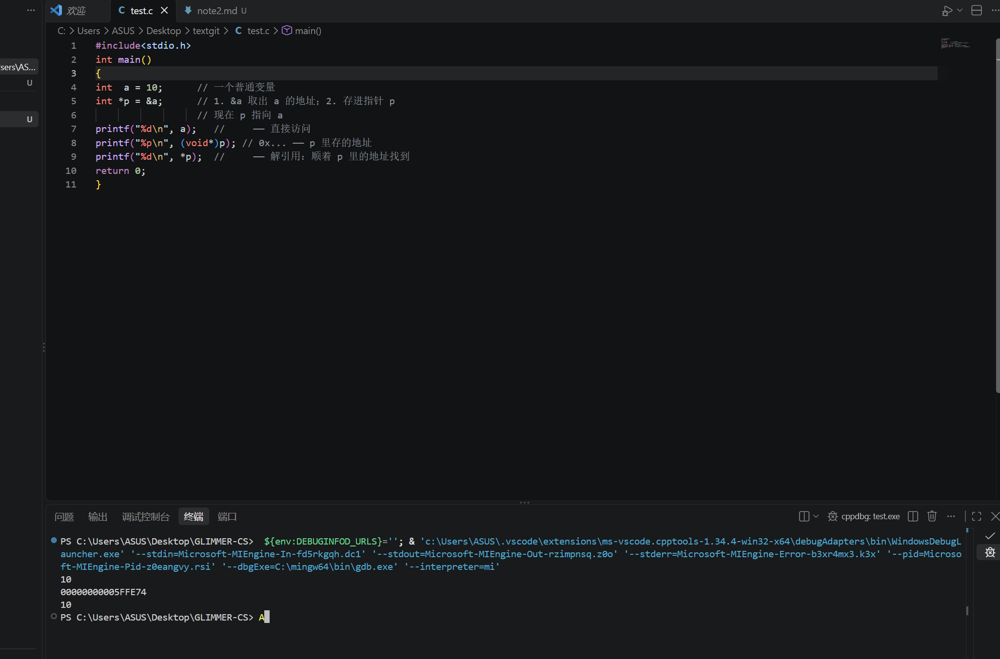
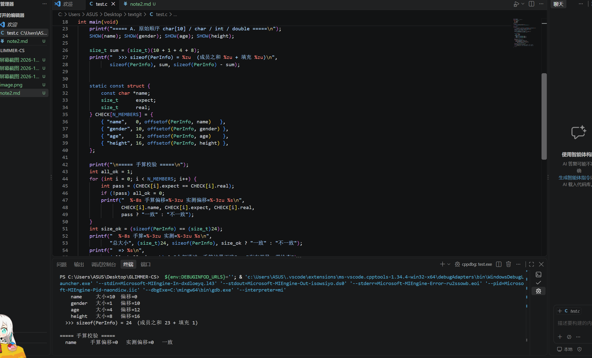
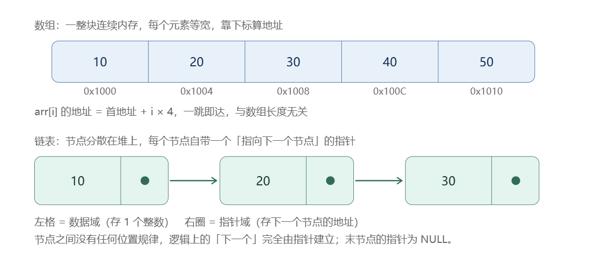

# 指针与结构体
## 指针
* #### 1.取地址与解引用：
指针是一个变量，它的值是一个内存地址。​ 
而 & 和 * 就是围绕地址做操作的这对"反义词"。

“ & ”：取地址符（address-of）取出变量的地址
“ * ”：解引用符（dereference）通过地址访问那个变量

 “*” 在声明里和在使用时是两个身份。​
声明时：int *p; → 这里的 * 表示"p 是一个指针"，不是解引用。
使用时：*p = 5; → 这里是解引用，访问 p 指向的那块内存。

>**question**：为什么地址不是0x的形式？
**answer**:确实是十六进制的格式（因为有E，F）。Windows上不习惯加0x，其实是一样的。可以在printf里加上“0x%p\n"就有了

指针变量的双重身份：
**p 自己也是一个变量，它有自己的地址，但它的值是 a 的地址。（解引用就是拿到a的值）**

 * #### 2.指针的用途

 ##### a.函数中修改外部变量
 void bad(int x)  { x = 100; }        // 传值：改的是副本，外面不变
void good(int *x){ *x = 100; }       // 传指针：通过地址改原变量

int main(void) {
    int a = 1;
    bad(a);   printf("%d\n", a);  // 1   —— 没改到
    good(&a); printf("%d\n", a);  // 100 —— 改到了
    return 0;
}

 ##### b.只传地址，避免拷贝大对象（结构体，数组）
 （函数参数默认是“值传递”）

 如：
 以void f(BigData d)需要拷贝大量字节，不能修改原对象；而void f(BigData *d)只需要拷贝8个字节（一个地址），且能修改原对象。
 *（数据越大，差距越夸张。链表节点、图像缓冲区、大矩阵——全部应该传指针。）*

>语法提醒：
 拿到结构体指针后，访问成员用 -> 而不是 .：
cd->scores[0]  等价于  (*d).scores[0]
 **BUT**如果结构体很小（比如只有两个 int，共 8 字节），传指针的间接寻址开销可能不比直接拷贝便宜，编译器优化时甚至会更愿意把值放进寄存器。经验法则：

* 结构体 ≤ 16 字节（约两个指针大小）→ 传值即可
* 结构体更大 → 传 const 指针（只读）或普通指针（需修改）

只读时加 const，既明确意图又方便编译器优化。

只读：属于权限的一部分。
权限通常分为三种：
只读（只能看）；
读写（能看也能改）；
完全控制（能看，能改，能删，还能改别人的权限）

##### c.动态内存＋数据结构
为什么需要动态内存？
栈上数组的大小必须编译期确定，且生命周期随作用域结束而销毁。运行时才知道要多大、或者要活得很久的数据，就得用堆（heap）​：

>int n;
scanf("%d", &n);           // 运行时才知道 n
int *arr = malloc(n * sizeof(int));   // 在堆上申请 n 个 int
if (arr == NULL) {                    // 必须检查！申请可能失败
    perror("malloc");
    return 1;
}
for (int i = 0; i < n; i++) arr[i] = i * i;
free(arr);                            // 用完必须归还
arr = NULL;                           // 立即置空，防悬垂

**malloc 返回的就是 void*——一个地址。指针是访问这块堆内存的唯一手段**

### 栈VS堆
1.内存分区是什么
一个 C 程序跑起来后，它占用的内存会被划成几块区域，各自职责不同：
#### C 程序运行时内存布局

##### 整体结构（地址从低到高）

| 分区 | 存放内容 | 生长方向 |
|---|---|---|
| 代码段 `.text` | 编译好的机器指令，只读 | — |
| 数据段 `.data` / `.bss` | 已初始化 / 未初始化的全局与静态变量 | — |
| 堆 heap | `malloc` / `new` 申请，手动 `free` / `delete` | → 向高地址生长 |
| 未映射区 | 堆与栈之间的空闲地址空间 | — |
| 栈 stack | 局部变量、函数参数、返回地址 | ← 向低地址生长 |
| 内核区 | 操作系统内核，用户程序不可访问 | — |

##### ASCII 图

低地址 ──────────────────────────────► 高地址

┌──────────────────────────┐
│ 代码段 .text             │  机器指令，只读
├──────────────────────────┤
│ 数据段 .data / .bss      │  全局/静态变量
├──────────────────────────┤
│ 堆 heap                  │  malloc 申请  ► 向高地址
├──────────────────────────┤
│ 未映射区（空闲）         │
├──────────────────────────┤
│ 栈 stack                 │  局部变量     ◄ 向低地址
├──────────────────────────┤
│ 内核区                   │  用户不可访问
└──────────────────────────┘

| 维度 | 栈 stack | 堆 heap |
|---|---|---|
| **谁管理** | 编译器自动 | **程序员手动**（malloc/free） |
| **生长方向** | 向**低**地址 | 向**高**地址 |
| **分配速度** | 极快（挪一下指针） | 较慢（要找合适的空块） |
| **空间大小** | 小（通常 1~8 MB） | 大（可用到几个 GB） |
| **生命周期** | 函数结束自动回收 | 手动 free 才回收 |
| **典型用途** | 局部变量、函数参数 | 大数组、动态数据结构 || 维度 | 栈 stack | 堆 heap |
|---|---|---|
| **谁管理** | 编译器自动 | **程序员手动**（malloc/free） |
| **生长方向** | 向**低**地址 | 向**高**地址 |
| **分配速度** | 极快（挪一下指针） | 较慢（要找合适的空块） |
| **空间大小** | 小（通常 1~8 MB） | 大（可用到几个 GB） |
| **生命周期** | 函数结束自动回收 | 手动 free 才回收 |
| **典型用途** | 局部变量、函数参数 | 大数组、动态数据结构 |

void f() {
    int a = 10;                        // 栈：自动分配
    int *p = malloc(sizeof(int) * 1000000);  // 堆：手动申请（400 万字节，栈放不下！）
    
    *p = 20;
    free(p);                            // 堆：必须手动释放！
}                                       // 出了 f，栈上的 a、p 自动死；但堆那块要你自己 free

**a和指针p本身在栈上，但p指向的那一大块内存在堆上**

**经典坑**：
a.内存泄漏（忘记free）
b.野指针（释放后使用）
**free(p)之后应该p=NULL,但加了之后用*p=10还是错的。**
>正确做法：
int *p = malloc(sizeof(int));
if (p == NULL) {        // ① 申请后检查是否成功
    return -1;
}
*p = 10;                  // ... 用完了 ...
free(p);                // ② 释放
p = NULL;               // ③ 立刻置空，防止悬空指针

c.忘记初始化
int *p = malloc(sizeof(int));  // 堆内存不会自动清零（和局部变量一样）
*p = *p + 1;                   // 垃圾值 + 1

>正确做法：
int *p = calloc(1, sizeof(int));   // 申请 1 个 int，并且自动清零
*p = *p + 1;                       // 现在是 0 + 1 = 1 
or
int *p = malloc(sizeof(int));
memset(p, 0, sizeof(int));    // 把这块内存的 sizeof(int) 个字节全填 0
*p = *p + 1;                  // 0 + 1 = 1 
or
int *p = malloc(sizeof(int));
*p = 1;              // 直接写，不读旧的——完美
// 不要写成 *p = *p + 1，那才需要初值

**全局/静态变量(BBS段)会自动清零；**
**局部变量（栈）和malloc出来的堆内存不会自动清零（垃圾值）。**

栈的优点：快，自动，不泄露
堆的优点：大，灵活，按需申请，能跨函数存活.

### 引申问题
什么叫向高地址或低地址方向生长？
>“向低地址方向生长” = 每压入一个新数据，它就占用比上一个更小的地址。
0x1000  [ 第一个压入的数据 ]     ← 栈底
0x0FFC  [ 第二个 ]
0x0FF8  [ 第三个 ]              ← 每压一个，地址 -4
        ↓ 新数据在这边，地址越来越小

 >“向高地址方向生长” = 每压入一个新数据，它就占用比上一个更大的地址。
 0x1000  [ 第一个 ]     
0x1004  [ 第二个 ]
0x1008  [ 第三个 ]              ← 每压一个，地址 +4
        ↑ 新数据在这边，地址越来越大

为什么叫“生长”？
>因为栈是可变的：函数调用越深，压入的数据越多，栈占用的范围越来越大——就像一棵树往某个方向长，所以叫“生长方向”。

栈的工作流程：（每调用一次函数,就在栈上压入一个栈帧）
>调用方压参数 → call 压返回地址 → 被调方压旧 ebp、为局部变量腾空间 → 执行 → 反向拆栈、ret 回到调用点。

压进去什么顺序,就要按相反顺序弹出来 

#### NEXT
#include <stdlib.h>

int global_init = 10;      /* .data 已初始化全局变量 */
int global_uninit;         /* .bss  未初始化全局变量 */

int main(void) {
    int  local = 5;                        /* 栈  局部变量 */
    int *heap  = malloc(sizeof(int) * 100); /* 堆  malloc 申请 */

    if (heap == NULL) return 1;

    heap[0] = 1;
    free(heap);                            /* 堆  手动释放 */
    heap = NULL;

    return 0;                              /* 栈  local 自动销毁 */
}

**全局or静态有没有初始化：**
* 已初始化（数据段）：
int a = 10;              // 全局，有初值 → 数据段
static int b = 20;       // 静态，有初值 → 数据段
* 未初始化（BBS段）：
int c;                   // 全局，没给初值 → BSS 段
static int d;            // 静态，没给初值 → BSS 段
***坑***：
全局变量/静态变量自动是0，但局部变量不自动清零，是垃圾值。（所以类似int sum不写等于0算不出来）
且局部变量都在栈里，函数能活多久它活多久
>BUT
int main() {
    static int x;      // 在函数里，但是 static
    printf("%d", x);   // 输出 0！（不是垃圾值）
}

**变量写在函数里 ≠ 局部变量。加了 static，它就脱离栈、搬进 BSS 段，从此享受“自动清零 + 活到程序结束”的待遇，只是外部看不见它（作用域还在函数内）。这就是“静态局部变量”的特殊之处——生命周期和作用域是两回事。**

生命周期和作用域的区别：

| 变量类型 | 作用域 | 生命周期 |
|---|---|---|
| 局部变量 | 自己的 `{}` 内 | 函数执行期间 |
| **静态局部变量** | **自己的 `{}` 内**（小） | **整个程序**（长） |
| 全局变量 | 整个文件 | 整个程序 |
| 全局静态变量 | 本文件 | 整个程序 |

**局变量尽量不要定义大数组，浪费空间，遇到大的尽量malloc
写初始值叫定义，不写初始值叫声明
想记住上次调用的状态用静态局部变量**

#### 指针的算术运算
指针能加减，但不是普通数字相加——它加的是"元素个数"，不是字节数。
核心规则：加法按"类型大小"走
>指针 p + 1 的含义是：跳到下一个同类型元素的位置，所以实际地址增加 sizeof(指向类型) 个字节。
char *p   p+1 前进 1 字节
int *p    p+1 前进 4 字节（sizeof int）
double *p  p+1 前进 8 字节（sizeof double） 

数组与指针：
数组<==>指向首元素的指针

**具体举例**
>int a[5] = {1,2,3,4,5,};    //数组
int *p = a;                 //指针
int i;
for (i=0; i<5; i++>)
{
    printf("d", 8（p+i)）  //通过指针形式访问数组，a[1]等价于*（a+i）
}

>char *str = "helloworld"
printf(%c\n, *str);   //通过数组的形式访问指针
for(i=0;i<10;i++)
{
    printf("%c", str[i]);
}

*区别：*
>char str[32]="hello world";
char *p ="helloword";
str++  // × 数组名是常指针（地址常量），不能修改
p++;    //指向下一个元素e
str[0]='x';
p[0]='x';    // × 字符串常量，不能修改
printf（“lu\n"， sizeof（str））；   //数组的长度   32
printf（“lu\n"， sizeof（p））；    //指针的长度    8

指针小练习：
* 有空格

* 无空格

***！！！！不要忘记free 和NULL!!!!***

#### 野指针：
未初始化的指针(wild pointer)和指向已失效内存的悬垂指针(dangling pointer)。

野指针常见的三种来源：

* 未初始化的指针   （int *p; *p = 10;）
指针从未赋初值，里面是栈上残留的垃圾值，解引用等于访问一个随机地址。
* 悬垂指针（内存已释放）   （free(p); *p = 10;）
内存已经归还，指针却仍指着那块旧址，它随时可能被另一次 malloc 分配走。
* 生命周期已结束的指针
函数返回后栈帧销毁，返回的地址指向一块已经失效的栈空间。

>**具体危害**可以归纳成四条:
崩溃:
访问非法地址触发段错误,程序直接终止(这其实是最轻的一种)。
静默数据损坏:改掉相邻变量、数组越界写坏别人,或者破坏 malloc/free 内部的堆管理结构 —— 于是崩溃点常常发生在几十行之后某个完全不相干的地方。
安全漏洞:
释放后使用(use-after-free)是最经典的可利用漏洞类型之一,攻击者可以借此做任意地址读写、覆盖返回地址。很多 CVE 都是这么来的。
难以复现:地址带随机化(ASLR),同一段代码改个无关变量、换个编译优化等级,bug 就"消失"了,排查成本极高。

>**如何避免**
防护的核心思路只有一条:让指针的生命周期和它指向的对象严格对齐。最有价值的一步是"释放后立即置空"。

>**写指针tips**
1.定义即初始化:
不确定指向谁就先给 NULL:int *p = NULL;,不要写 int *p; 就放着。
2.分配后必检查:
 malloc/calloc/realloc 可能失败,if (p == NULL) return -1;。注意 realloc 之后要用它返回的新指针,旧指针已经失效。
释放后立刻置空,并且保证每块内存只 free 一次(重复 free 会直接破坏堆结构)。释放链表节点前,先把 next 存下来。
3.清理函数收口:把 free 和置空写成 destroy_xxx(T **pp),调用方传地址进来,函数内 free(*pp); *pp = NULL;,避免调用方忘了置空。

***！！！搞清楚谁来free！！！***

##### swap函数：

void swap(int *a, int *b) {
    int t = *a;
    *a = *b;
    *b = t;
}
swap(&x, &y);     

## 结构体
>使用原因：现实中的一条记录往往由多个不同类型的字段组成(学号是整数、姓名是字符串、成绩是浮点数),散着放很难管理,于是把它们捆成一个整体。

定义，初始化，访问：

struct Student {          /* 定义一种类型：此刻还没有分配任何内存 */
    int    id;            /* 成员就是普通变量，可以有任何类型 */
    char   name[16];
    double score;
};                        /* ← 这个分号千万不能省，最常见的报错来源 */

struct Student s1 = { 1001, "小明", 92.5 };        /* 按声明顺序初始化 */
struct Student s2 = { .score = 88.0, .id = 1002 }; /* C99 指定初始化器，未写的成员为 0 */
struct Student s3 = { 0 };                          /* 全部清零，最稳妥的初始化 */

s1.score = 95.0;                                   /* 用 . 访问成员 */
printf("%s %d\n", s1.name, s1.id);

#### 结构体定义：
typedef struct PerInfo {
    char   name[10];   /* 1. 个人姓名：字符型数组*/
    char   gender;     /* 2. 性别：字符型 */
    int    age;        /* 3. 年龄：整型 */
    double height;     /* 4. 身高：双精度浮点型（米） */
} PerInfo;

#### 结构体指针：
指针存的是地址,结构体是一块内存 —— 所以"结构体指针"就是存着某个结构体实体地址的变量

>为什么需要结构体指针：
1.避免拷贝 —— 结构体可能很大,传值会整块复制,传指针只复制 8 字节。
2.让函数能修改调用方的结构体 —— 这就是 swap 那一问的道理,值传递改不了原件。
3.动态分配只能拿到指针 —— malloc 的返回值就是指针,你没有别的选择。
4.链式结构必须用它 —— 链表、树的 next 成员只能是指针。

**拿到结构体指针访问的两种形式：**
**（'*'p）.age = 21**   or
**p->age = 21**

**区分**
&p1     = 000000A99FBFF740   (p1 自己的地址)
p       = 000000A99FBFF740   (p 存的内容，和上面一样)
sizeof(p1) = 24 字节 (结构体实体)
sizeof(p)  = 8 字节 (指针变量本身)

list     地址 = 000000A99FBFF6F0
list + 1 地址 = 000000A99FBFF708
相差 24 字节 —— 等于 sizeof(PerInfo)，不是 1 字节

>&p1 和 p 打印出来完全一样,这正是"指向"的含义 —— p 的值就是 p1 的地址。而 p 和 p1 是两个变量,一个占 8 字节、一个占 24 字节。

##### const:
void print_info(const PerInfo *p)   /* 只读，不修改 */
{
    printf("%s %d\n", p->name, p->age);
}

>const PerInfo *p 表示"p 指向的内容不能被修改"。函数里一旦写 p->age = 30; 编译器立刻报错。它的价值有两个:一是防止自己手滑改坏调用方的数据,二是让读代码的人一眼看出这个函数没有副作用。​只要是"只读"的结构体参数,都应该加 const。

| | `PerInfo p1;` | `PerInfo *p = &p1;` |
|---|---|---|
| 是什么 | 结构体实体本身 | 存地址的变量 |
| 占多少内存 | 24 字节 | 8 字节 |
| 访问成员 | `p1.age` | `p->age` 或 `(*p).age` |
| 作为函数参数 | 整块拷贝,改不到原数据 | 只传 8 字节,能改到原数据 |
| 何时必须用 | 局部临时对象 | 传参、动态分配、链表、数组遍历 |

* 总结:
结构体指针 = 一个存着结构体地址的变量。它有两种身份要分清 —— 指针变量自己只有 8 字节,但它指向的那块结构体是完整的 24 字节;用 -> 访问成员时,操作的始终是"被指向的那个实体",而不是指针本身。把这一点和第 1 问的指针算术、第 2 问的野指针、第 4 问的传参规则串起来,链表你就能自己写出来了。

#### 结构体内存对齐的三条规则：
1.每个成员的起始偏移量必须是自身对齐数的整数倍
2.结构体总大小必须是最大对齐数的整数倍
3.数组的对齐数看元素类型，不是总长度

计算长度：
name 10字节
gender 1字节
sex  4字节（要从12开始算）
height 8字节
共24

**改变定义顺序：按从大到小顺序排列，可以最大限度节省空间
BUT
这种定义改成先double后int然后char，char还是24（因为要是8的倍数）**

## 链表

一、链表与数组的存储对比
数组(顺序存储)​:开一整块连续内存,所有元素等宽,元素之间的位置关系可以直接算出来 —— arr[i] 的地址 = 首地址 + i × sizeof(元素)。所以"逻辑上相邻"和"物理上相邻"是同一件事。

链表(链式存储)​:每个节点单独申请一块内存,位置由系统随机分配(上图程序实测的地址 0x…3100 → 0x…30C0 → 0x…3200 就是不连续、甚至不递增的)。节点之间的"下一个"关系不靠位置维持,完全靠节点自己带的那根指针。

>数组用"位置"表达顺序,链表用"指针"表达顺序。前者换来随机访问,后者换来灵活的插入删除。

| 对比项 | 数组 | 单向链表 |
|---|---|---|
| 存储空间形态 | **一整块连续**内存 | 若干**离散**节点，散落在堆上 |
| 元素/节点构成 | 只有数据本身 | **数据域 + 指针域**两部分 |
| 逻辑相邻 = 物理相邻 | 是 | **否** |
| 定位方式 | 下标计算：`首地址 + i × 4` | 从头指针沿 `next` 逐个走 |
| 随机访问 `[i]` | **O(1)**&#8203; | O(n) |
| 中间插入/删除 | O(n)，要搬移后续元素 | **O(1)**&#8203;（已定位时），只改指针 |
| 长度 | 定义时固定，满了要扩容搬家 | **运行时随时增减** |
| 额外空间开销 | 无 | 每个节点多 8 字节指针 |
| 访问速度（缓存） | **快**，连续命中缓存行 | 慢，每次跳转可能缺页 |
| 存储结构名称 | 顺序存储结构 | 链式存储结构 |

### 二、单向链表节点的结构特点

* 节点由两部分组成:数据域(data)和指针域(next)。
* 数据域存放数据元素本身,类型由具体问题决定
* 指针域存放其直接后继节点的存储地址,即"指向下一个节点"的指针。
* 指针域的类型必须是指向本类型结构体的指针(struct Node *),因为要存的正是"同一种节点的地址"。
* 节点在内存中不要求连续存放,相邻节点之间的逻辑关系由指针建立,而不是由物理位置决定。
* 最后一个节点的指针域为空(NULL)​,它是链表结束的标志;空链表则用"头指针为 NULL"表示。
* 必须额外维护一个头指针,它是访问整条链表唯一的入口;丢了它整条链就找不回来了。
* 每个节点占用的字节数固定(本机实测 16 字节),但链表长度可以随时动态变化。

>typedef struct Node {
    int          data;   /* 数据域：存放 1 个整数 */
    struct Node *next;   /* 指针域：存放下一个节点的地址 */
} Node;

>成员访问形式：
 n.data  = 99    （变量用 . ）
  q->data = 99    （指针用 -> ）
  (*q).data = 99  （等价写法，括号不能省）

  ！！！next前必须要加*！！！！